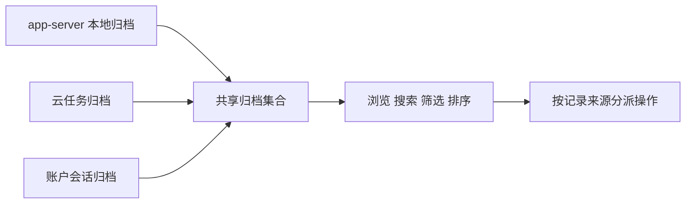

# 归档功能的共享归属与保留边界

现有“浏览搜索筛选及排序归档记录”（FSC-0280）归为 `shared`：同一入口把 Codex app-server 本地归档、云任务与账户会话交给同一套浏览、搜索、筛选和排序界面。恢复时保留这套共享逻辑，分别维护三类数据适配器。

账户归档查询在 `includeWorkCloud=false` 时排除 `tpp` 来源，启用时取消排除。账户会话适配器因此不能按 `chatgpt` 名称整块删除。数据转换保留原始 task/thread 对象和 host，后续操作仍能按来源分派；共享集合不意味着三种恢复或删除协议可以合并。

| 已有功能 | 当前归属 | 恢复处理 |
| --- | --- | --- |
| 浏览搜索筛选及排序 | shared | 保留共享集合与界面，分别接入数据适配器 |
| 删除本地归档 | unknown | 保留本地协议；后台身份不单独证明产品模式 |
| 恢复归档云任务 | unknown | 保留云任务恢复分支，继续核对模式消费者 |
| 取消账户会话归档 | unknown | 保留；混合来源不足以证明 ChatGPT 专属 |
| 删除账户归档会话 | unknown | 保留；另有 work companion 清理关系待核对 |

四个 provider 导入已按完整 Program 的导出与词法绑定连接。10 项合成数据隔离用例通过，覆盖来源聚合、身份保留、查询来源过滤、分页以及恢复成功和失败。首次隔离工具因编译含 `import.meta` 的静态证据函数失败，修正工具只加载待执行函数后通过；原源码未改。实际客户端、账户、服务与持久化未在本批验证。

[源码合同与决定](archive-mode-ownership.json)、[台账 v22](feature-scope-v22.json)和[恢复覆盖表 v13](restoration-coverage-v13.json)已同步。有限功能总数仍为340，模式归属为 shared 1、unknown 339；1117 条产品场景规格仍未执行。原九项标准保持4项资料或范围义务有交付、5项部分完成。
