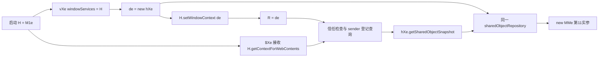

# 仓库注入、窗口 context 与首次快照

本批关闭所选启动路径上的静态连接：hXe 创建的共享仓库直接注入 MMe；vXe 创建的 hXe 经窗口服务登记，再由首次快照接收器取得。见[20条限定合同](host-state-di-contracts.json)、[证据行](host-state-di-evidence.jsonl)、[26项隔离观察](host-state-di-observations.json)、[7条待执行规格](host-state-di-scenarios.json)和[完整归档索引](host-state-di-provenance.json)。这是固定基线的分析增量，没有生成客户端工程。

| 连接 | 本批证据 | 结论适用范围 |
| --- | --- | --- |
| hXe → MMe | new MMe 第11实参为 this.sharedObjectRepository，第11形参 f 直接赋入接收方字段 | 这一构造路径传递同对象，没有复制；真实构造未执行 |
| vXe → 窗口服务 | de=new hXe 后，m.setWindowContext(de) | 同一工厂局部实例被登记 |
| 启动 → 两个使用方 | H=M1e(...)；vXe 接收 windowServices:H，$Xe 接收 H.getContextForWebContents | 完整 Program 的 H 绑定相同 |
| 窗口服务 → 快照 | getContextForWebContents 返回已登记 sender 对应的 R；$Xe 再调用快照方法 | 真实窗口登记、frame 和 IPC 送达未观察 |

图示是源码构造和闭包连接，不是实际窗口／IPC 追踪图。MMe 保存注入仓库后登记 subscriber，并沿用上一批按键分发 sender 的代码。hXe.getSharedObjectSnapshot 从相同字段取浅快照，getMessageHandler 返回其 messageHandler。本次完整 Program 分析在 hXe 与 MMe 各找到这一处 sharedObjectRepository 直接赋值；未排除其他对象通过别名或反射修改实例。

vXe 实际是函数工厂。它把局部 de 创建为 hXe，再交给同一 m 的 setWindowContext，返回的 getWindowContext 也闭包引用 de。M1e 维护初始为 null 的 R 和窗口管理器 z；setWindowContext 先 R=e，随后只为未销毁、属于 appServiceWindowIds 的现有窗口调用 e.registerWindow。该调用抛错时，函数内没有回滚 R，并停止处理后续窗口。getContextForWebContents 只有 sender.id 已在 registeredWebContentsIds 时返回 R，否则返回 null；身份已登记时 R 仍可能为空。

y1e.registerWindow 先写入窗口／webContents 集合与映射，再安装 closed listener，最后按 register 类型调用 onWindowRegistered。appServiceWindowIds 只在该类型加入。closed callback 删除对应身份。本批所选类内直接 add/delete 的位置均落在这个方法及其 callback，真实关闭事件是否送达没有新观察。listener 安装或回调抛错会保留此前写入，这些异常只在合成窗口中触发。

实际启动用 Oe 调用 H.isTrustedIpcSender(sender,senderFrame??null)，窗口服务保存的是 z.isTrustedIpcSender.bind(z)。窗口管理器在非空 sender.id 未登记时直接拒绝，否则委托 x1e。x1e 要求提供的 frame 与 sender.mainFrame 为同一对象，再按对应 URL 调用 P9；未提供 frame 时使用 mainFrame。

P9 接纳 about:blank、app 协议且 host 为空或 - 的 URL、与 renderer URL 相同的 HTTP(S) origin，以及以本地 index.html 文件 URL 开头的字符串。M9 使用 ELECTRON_RENDERER_URL 或默认 http://localhost:5175/；文件条件使用 startsWith，不能改写为严格相等。VM 的环境字典、frame 和 URL 均为合成输入，没有读取用户真实环境或访问这些地址；node:path／node:url 使用本机 Node22 内置候选实现。

$Xe 的快照 callback 先调用传入信任检查，拒绝时返回 {}；通过后执行 getContextForWebContents(sender)?.getSharedObjectSnapshot()??{}。未登记、context 未安装或快照返回 nullish 都可能得到空初值。同步校验／快照异常没有在该 callback 内捕获。preload 将同步结果保存为 A，getter 读取这个缓存；后续消息更新仍属于上一批单独保存的链路。没有把“初值快照不自动变化”当作真实订阅故障，也未新增磁盘持久化证明。

修正版一次 Node22 VM 命令执行 24 个保存单位共 3947 字节，26 项全部通过。覆盖窗口登记与关闭、frame 身份、URL 条件、context 安装和失败顺序、浅快照及 preload 初值。窗口、IPC、构造上下文和 process.env 均为明确替身；MMe、hXe、vXe、M1e 的完整构造／工厂没有执行，没有真实客户端、设置操作或模型任务。

此前一次 VM 命令执行 25 项，24 通过、1 断言失败：观察器替换 z.isTrustedIpcSender，窗口服务已保存的 bound 函数继续调用原实现，预期异常未发生。修正版把故障注入放在 H 接口，另加 bound 函数保持行为的场景。两次共 51 次场景执行，规范不同场景数为 26；不是 51 项独立功能。两版目标选段字节相同，首轮结果及两份工具源码完整保留。

分析工具共五次命令尝试，三次成功完整解析同一个 main Program。前两次已完成解析和 scope 构建，却因把函数 vXe 预设为 class 而在派生断言停止；保留其六个部分选段和错误记录，不当作 JS parser 语法失败或规范结果。当前合同包含 18 条源码事实／2 条维护推断、47 个规范单位（43 新选段、4 继承选段；长度合计 52734 字节，含重叠）及 1403 处去重词法位置。没有新的 REA 执行或独立语义审查，既有 REA partial／unknown 结论不改。

这关闭了上一批“仅因同字段名而尚未连接”的静态仓库注入缺口，以及首次快照注册参数和 context 来源。仍需核对实际构造实例、真实窗口与消息时序、React provider、远程连接查询和上游配置持久化。重建可将窗口登记、信任解析、context 安装、共享仓库与快照读取分责，保持同对象身份及先写后回调顺序；这些是维护设计建议，不是恢复原作者目录。

原 37 项有限功能、40 用户操作／5 机制／26 队列、160 条功能待执行规格、967 未映射旧入口及 337 deferred 保持。新增 7 条真实客户端规格全部未执行并单独计数；模式分类和确认排除未增加，完整功能分母仍未知。本组获批模型样例 2/2 已用、余0；本批没有新增提交。总体分析目标继续保持未完成。
