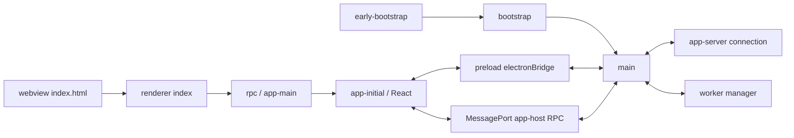

# Codex 客户端逆向分析阶段报告

<!-- CURRENT-ANALYSIS-VIEW -->
已补齐[历史行为基线归属](behavior-baseline-attribution-v1.md)：四条既有行为对照连接 ASAR/CLI 哈希、进程与任务身份。正常完成/手动重开可在限定范围引用；失败终态、取消、执行恢复仍未验证，新增产品通过为0。

已完成[首页建议正式归入](home-suggestion-adoption-v1.md)：六项已发布候选去重后新增两个功能；插件引导和入门建任务扩展既有安装/创建目标。补齐非chat首页保留条件、各动作接受/失败时序及准入/目录/动作三项维护职责，实际行为仍未验证。

当前有限清单527功能、609不同用户操作（610次出现）、125支撑、1930未执行规格（1933功能链接）、51任务；模式517unknown/10shared。969来源、700无功能映射、240明确机制、460待用途决定按currentSourceAccounting有效引用；不使用功能账本内的历史来源统计替代它。

[功能清单](feature-scope-v57.csv) · [模式处置](feature-mode-dispositions-v15.csv) · [模块归属](feature-module-ownership-v23.csv) · [恢复覆盖](restoration-coverage-v48.json) · [实施增补](implementation-plan-v12-home-suggestion-addendum-v1.json)

原39要求、九项分析标准、M1–M7与两张60节点图保持。复用原计划验收v7及后续显式增量；①⑤⑥⑦⑨仅为有限资料/方案义务支持，②③④⑧部分满足。完整分析未完成；运行时可采用来源/ABI、主要行为和影响完整复刻的服务/持久化未知仍是实质缺口。历史三条模型样例余0，不限制其他已授权分析。
<!-- /CURRENT-ANALYSIS-VIEW -->

## 历史分析记录

以下保留既有批次记录；其中旧版本数字与当时的“下一步”不代表当前有效状态。当前入口与计数以上方覆盖层和 analysis-state.json 为准。

[Composer 模式取舍](mode-composer-disposition-v1.md)已关闭 Ezt/wzt 参数与回调，并将 FSC-0481 按跨产品职责分类为 shared。当前模式按基础账本加显式覆盖层计算：502 unknown、2 shared；504功能、操作、规格和职责数量保持。ChatGPT入口按分支取舍，整个 Ezt/共享协调器仍不能删除。无新增运行通过；下一批限定七项本地线程目标。

[显式模式切换契约](mode-explicit-switch-v1.md)已关闭 a1s/kti/gS 的参数和直接状态变化：主页 chat/work 与 detail-level work/codex 分开；kti 不调用 gS。访问引导、七种导航恢复及异步回滚有源码依据，实际模式切换未验证。本批补13条事实、8条未执行子规格，全部全局计数保持。下一步限定同一功能的 Ezt 变体与逐入口取舍。

[模式初始化限定结论](mode-bootstrap-consumer-v1.md)已关闭根组件至持久化初始化器的具名调用方及窗口条件来源：排除键对应 avatar-overlay，不能作为产品模式剥离条件。ChatGPT 项目组件内存在本地 Codex 任务分支。本批只补来源证据，功能/规格/职责计数保持；下一步限定 FSC-0481 的显式模式切换参数与 guard。

当前为 REA 分析与实施设计阶段，完整分析未完成，客户端实现尚未开始。

[本地线程控件功能接纳](local-thread-chrome-adoption-v1.md)已完成4个候选的去重、功能/操作标识、任务归属和规格登记：线程静态快照分享、子代理内容或总览、PR详情面板、停止会话全部后台终端。新增4功能、5用户操作、25条未执行规格与2项职责提议。直接分享导出仅保留接口变体，不额外计用户操作。

497项旧功能保持原值；摘要、重命名和终端展示3项只追加源码/规格引用。1761条旧规格、968个来源身份、两套60节点任务图与此前两项源码补充完整保留。T03拥有分享/子代理/终端协调；T06拥有PR详情，T03消费入口。

当前[504项功能 v48](feature-scope-v48.json)、571个不同操作（572次出现）、125支撑与[1786条未执行规格 v45](feature-scope-v45-scenarios.json)关联至[51项任务 v39](restoration-coverage-v39.json)和[任务图 v22](restoration-current-ordering-v22.json)。[职责 v14](feature-module-ownership-v14.json)含106项限定职责提议、48个粗facade和2479个源码见证。[实施计划 v11](implementation-plan-v11.md)与[当前补充](implementation-plan-v11-local-chrome-addendum-v1.json)继续保留原M1至M7和九项完成标准。

源码范围、哈希、引用和旧条目保留检查通过；这些检查不证明产品运行通过。模式503项unknown、1项shared；[715条未关联来源](retained-entry-backlog-v11.json)、20命令消费者、PR次级入口、主要行为、有效运行时与独立构建缺口保留。此前[面板补充](thread-panel-header-refinement-v1.json)与[本地控件源码合同](local-thread-chrome-refinement-v1.json)继续有效，后者的候选待登记状态作为历史记录由本批覆盖。

本批没有新源码解析、REA运行、目标/模型/服务调用、剪贴板或Git写入，也没有客户端实现。下一步限定一个已具名的模式初始化调用方及直接消费分支，优先补齐ChatGPT剥离依据；不因缺少运行验收递归展开所有提供方。

[当前状态](analysis-state.json)

## 此前阶段记录

[命令声明去向v1](command-registry-destinations-v1.md)已逐项审阅181条声明：50条通过实际元数据生产者、别名或有限生成器有条件关联既有功能；57条定位到具体注册回调/owner；66条保留字面库存外或参数化消费者缺口，8条保留平台消费者缺口。131条业务消费者仍未闭合，不能宣称命令分析完成。

源码复核纠正恢复方式：Pw的keyboardHandler/contextHandler可先于默认回调执行；closeOtherTabs和前后标签切换的空回调不等于空操作。Git同ID注册的条件和分支不同，generic approval也不能按名字并入MCP审批。[逐条CSV](command-registry-destinations-v1.csv)与[证据](command-registry-destinations-v1-evidence.jsonl)保存具体来源。

[来源v15](legacy-entry-dispositions-v15.json)保留全部968条，825条无功能关联包含8个明确菜单机制；[剩余队列v2](retained-entry-backlog-v2.json)全部保留。该来源统计覆盖v36内的历史来源数字，50条新增关联不增加功能定义。

当前仍为[435项功能v36](feature-scope-v36.json)、464用户操作、118支撑、[1440条未执行规格v33](feature-scope-v33-scenarios.json)、[50任务v27](restoration-coverage-v27.json)。自动化候选归并、[435项职责映射v2](feature-module-ownership-v2.json)和[两套59节点图v10](restoration-current-ordering-v10.json)保持原合同；本轮不生成新的功能账本或实施计划。

本轮190条证据、26个冻结文件中的406处范围、34份引用文件及2456个JSON定位核对通过，只证明限定的源码和关联。没有新增客户端/模型/服务调用、客户端实现或产品/构建通过；九项完成标准状态不提升。

下一子步核对focusTab、environmentAction、page.format三组共21条候选的有限ID生产者、import/export、JSX参数和动态注册owner。其他命令、来源及逐功能存储缺口继续保留，已确认provider不重查。完整分析仍未完成。

## 历史阶段快照

以下记录保留其当时范围、数字和下一动作；当前以顶部功能归属整合及 analysis-state.json 为准。

当前补充：[需求处置复核 v5](analysis-stage-decisions-v5.md)已逐条对照原39项要求和九项标准，退休14组具体重复待办。37职责十字段、968来源角色分类及选定关联/运行时/协议源码子步已交付；完整用户功能与统一模块映射仍缺。源码工作与外部前置各列4组，外部条件不阻断这些静态任务。九项标准仍为4项有限资料义务有交付、5项部分完成。[措辞限定](analysis-stage-decisions-v5-qualification.json)：协议差异中的10表示通知变体数，不是独立字段数。

[实施计划 v10](implementation-plan-v10.md)已统一 373 项有限功能、48 个任务、1216 条未执行产品规格与两套 57 节点依赖图。37 个既有逻辑职责及 19 条重叠规则、15 组运行时能力（含 RAM-02/04/06 的后续源码结论）、11 个存储域、11 个后台差异变体和 30 条构建输入均接入工作包。M1 至 M7 的完整验收未变，客户端实现尚未开始。

[发布回读](../../.analysis-local/restoration-plan-v10-work/published-verification.json)核对 77 份引用文件、297 个 JSON 定位，以及全部功能/场景 ID 和任务依赖；仅证明设计引用一致，不是产品或构建通过。原九项标准未提升，完整分析仍未完成。来源角色采用 v5：968 条记录待审阅 0，功能映射仍缺 962 条；源码角色与完整功能身份分开统计。

历史 v5 下一项（现已完成该固定批次）为 SQ-01：将应用菜单12条已定位schema与现有373项用户功能去重，逐条给出功能/变体/支撑去向、模块及待观察边界。复用已完成Task Manager入口和更新/debug策略，不执行菜单动作或重复原生探针。模型授权余0；其余静态工作继续，实施计划仍为v10。

## 历史专项记录

以下叙述按各自产物时间保留，旧数量、当前指针和后续动作以上方 v10 及[状态文件](analysis-state.json)为准。已解决的 JS owner、设置页操作和协议差异问题不因原生验收未完成而重新盘点。

[固定运行时接口差异](runtime-surface-disposition.md)核对229条已解析路径：212条有公开声明，17条在固定描述中缺少且自有实例读为undefined；6个公开正例存在。读数完成后退出超时，已终止且无残留，不计完整运行成功。浏览器接收方已有静态证据已同步，完整替代路线未选定；下一项限定为runtime feature键、策略predicate及实际provider。

[Chat分支取舍决定](chat-branch-decisions.md)明确3组Chat专用源码分支在重建时排除，并为已有FSC-0048登记正向Codex保留依据；25项隔离回放通过。当前[台账v25](feature-scope-v25.json)／[覆盖表v16](restoration-coverage-v16.json)保持373项定义、48任务组及1216条未执行规格；3组分支决定与0项整功能排除分别统计。

[云环境创建／编辑委托补充](cloud-environment-editor-contracts.md)接上既有T46的实际编辑器：30项局部源码用例通过，明确分流、名称检查等待、提交与关闭时序；校验、报文、服务／缓存、表单库和委托组件保留5组具体provider问题。功能、场景分母及九项完成标准不变。

当前以[状态文件](analysis-state.json)和[最后三个设置页面的操作与边界合同](settings-operation-batch-15.md)为准。[台账v24](feature-scope-v24.json)含373项有限定义、377项用户操作、116项支撑与1216条未执行规格，接到[恢复覆盖表v15](restoration-coverage-v15.json)的T01至T48。45个设置容器中45个已有局部合同、0个待展开；完整产品分母仍未知。

本批新增33项有限目标、13项支撑、99条规格，36项精确源码隔离用例通过；区分云环境删除／缓存／迁移、主机和账户指令、记忆级联以及Micro的等待保存／即时写入／同步关闭。 委托服务、模式与持久化缺口保留在对应任务；原九项标准仍为4项资料/范围义务有交付、5项部分完成。客户端实现尚未开始。以下旧数量与下一行动为历史记录。

其他当前恢复决定：[当前统一实施计划](implementation-plan-v9.md)、[当前分析关闭条件](analysis-stage-decisions-v3.md)、[归档共享模式证据](archive-mode-ownership.json)、[旧入口逐ID处置](legacy-entry-dispositions.json)、[首页分流与共享提交边界](product-flow-ownership.md)、[原生浏览器运行时对照](native-browser-settings-comparison.md)、[浏览器克隆合同](browser-clone-route-qualification.md)、[公开历史复制实测及失败属性](public-history-duplicate-comparison.md)、[共享账户访问与模式剥离边界](desktop-access-publication.md)；继续作为对应模块的恢复依据。

[阶段决定表](analysis-stage-decisions-v2.md)按九项标准、六阶段和39条子要求收束现有成果：四项资料/范围义务有交付，五项部分完成；剩余工作归为六组，完整目标不变。[浏览器接收契约](browser-ownership-contracts.md)新增九条静态事实；公共探针证明移动同一view保留内存状态、重建附着view被拒绝。[设置入口关联](settings-feature-entry-conditions.md)已将42项功能接到三个页面条件，另6项保留非设置入口理由；212条场景均接上条件引用。[其余50个分支处置](settings-section-dispositions.md)已完成：42个页面容器、3个tab别名、2个重定向、1个appRoute链接及2个目录外工厂键；新增52个模块Program解析和60个隔离纯函数用例。[Git页面合同](settings-git-page-summary.md)已交付10项偏好和1项支撑操作，21项隔离用例通过；当前[台账v8](feature-scope-v8.json)含58项有限功能、260条未执行产品规格。[设置操作第二批](settings-operation-batch-02.md)交付Worktrees、键盘与文件处理器15项用户目标，29项隔离回放通过；当前[台账v9](feature-scope-v9.json)含73项有限定义、316条未执行规格。其余38个页面继续按批处理，运行/去重缺口独立列队。

[公共运行时对照](public-runtime-comparison.md)已完成：固定 Electron 42.3.0 缺少已观察到的 Owl 私有能力，不能直接替换；公开历史恢复保留了合成表单状态，但没有保留编辑后的 JS 堆值。权限查询为 false 时自有 TCP/Unix socket 仍能往返，不能以该值宣称隔离成立。探针均已结束，没有增加原客户端或模型任务。

[原能力要求](runtime-capability-decisions.md)继续保留；完整功能、模式、独立运行时、ABI 和实际客户端行为缺口未关闭。以下各批次的“下一项”属于当时记录，当前以顶部阶段决定表及 stageDecisions 为准。

[命令消费者批次已结案](command-consumer-summary.md)：24个import均已确认，新增56处直接调用；与initial合计105处、80个不同静态ID。没有增加功能或实际行为通过数。下一项转A2运行时能力/依赖决定，已完成的import不再重复调查。

[Renderer命令注册](command-registration-summary.md)已关闭旧6处callee身份缺口，并在完整app-initial中登记同一Pw绑定的49个直接调用；另有24个IBn import词法候选待作跨文件核对。未增加功能、模式分类或实际行为通过数。

[旧入口分组](entry-family-summary.md)已将968条记录定位到9个完整Program，建立10类机制和165个词法所有者组；53条旧设置候选确认为图标/导航资源描述，182条命令元数据仍与handler注册分开。该结果改变下一批盘点入口，不增加用户功能、模式分类或真实行为通过数。

当前[功能视图v7](feature-scope-v7.json)为48项定义、52用户操作、22支撑、1项旧resume关联待审；212条规格未执行，73根/75行为条目及12项关联待办保留。[普通创建/MCP调查](thread-start-entry-summary.md)纠正旧start为MCP辅助会话，另登记普通新建；25个隔离场景通过，真实provider、模式、服务、prewarm与持久化仍未验证。[计划v6](implementation-plan-v6.md)接下来批量关联旧入口，完整产品分母仍未知；此前数字按历史快照读取。

当前[功能视图v6](feature-scope-v6.json)为47项定义、51用户操作、21支撑、2项关联待审；208条规格未执行，72根/74行为条目、12项关联待办保留。[fork调查](thread-fork-entry-summary.md)已交付具体入口与条件合同、21个隔离场景；已取得ID后的设置失败保留身份，上层pane失败仍可能阻止导航。真实receiver、模式、worktree和存储未验证；完整产品分母仍未知。[计划v5](implementation-plan-v5.md)下一项追普通/MCP start；此前批次数字按历史快照读取。

[resume入口与恢复语义](thread-resume-entry-summary.md)已找到页面→hook绑定，19个隔离场景通过；完整hydration、实际RPC实例、存储与模式仍未验证。当前v5只注记候选状态，46项功能和200条未执行功能规格不变；[计划v4](implementation-plan-v4.md)接下来追fork入口。未新增模型提交或客户端运行。

[归档入口与预热清理纠正](thread-archive-entry-summary.md)已进入 v4：46 项有限功能、50 个用户操作、21 个支撑与 3 个入口/协议关联待审，200 条功能规格未执行。71 个原始根保留，另增一个具体用户归档根后为 72；拆分 WSL 后为 74 条行为。原 12 项关联/集成待办全部保留。

本次新增 17 条源码事实与 19 个通过的隔离源码场景；实际 RPC 实例、持久化与客户端归档仍未验收。42 项定义条件性关联同一个设置路由容器，另 4 项旧入口身份待定；旧入口完全解决 0、未完成映射 967，模式 unknown 46、确认排除 0、完整分母未知。[当前计划 v6](implementation-plan-v6.md)接下来追 fork 入口。未新增客户端运行或模型提交。

旧 v1 至 v3 快照及计划保留；下文数量按历史范围解释。当前读者以 `analysis-state.json` 的 `featureScopeCurrentView` 与 `analysisMilestones` 为准。

状态：分析进行中。固定基线 `codex-26.1007.30912-c5b273322a83`，版本 `26.1007.30912`，构建 `20156`。本报告未宣称分析完成或客户端已重建。

## 已取得的证据

REA 6.4.0 正式运行已结束，退出码 0，原始 Evidence `ev_a5444ee54c884ff9968b8c226a34a5048c96abba91411eafffa27a32d5bc36cb`。完整输出 635,380,481 字节；摘要流式读取了全部 JSON，并核对输出哈希和基线 ASAR 哈希。

| 范围 | 实际覆盖 | 限制 |
| --- | --- | --- |
| ASAR 文件盘点 | 21,089 个成员 | 盘点不等于功能分析 |
| REA 源码输入 | 16,240 个；JS 解析 15,212 个；解析失败 0 | 结构图 partial，语义图 partial 且 truncated |
| 结构图 | 63,168 节点，63,444 边 | 静态关系，不证明运行可达 |
| 语义图 | 56,258 节点，26,243 关系，226,389 unknown 记录 | 100000 节点上限和结果预算；省略总数未知 |
| Source map | 17,848/17,848 文件；11,316 条真实注释 | 冻结清单所列扩展中，所有目标 map 缺失；外置、内联和 sourcesContent 均为 0 |
| 依赖 | 78 根声明；49 ASAR、58 外部安装包 occurrence；202 个合并清单条目 | 仅 6 根声明有根路径安装版本；模式及其余包的修改状态仍 unknown |
| 精确版本上游比较 | 5 个根包；共同源码 69/71 相同 | node-pty 两个 Windows JS 不同；原生来源、ABI 和运行未验证 |
| 内嵌依赖定向调查 | 两批累计 255 条证据、17/17 既有版本声明绑定；9 条首批契约与 2 条应用适配器候选 | 每 hint 的来源、处理建议与五项调查动作已登记；实际上游身份/修改与运行仍未验证 |
| 原生和 Wasm | 66 个 .node、42 个 Wasm 工件 | 含其他平台；存在不证明能从源码构建 |
| 桌面运行时 API | 10 核心文件、90,246 call/new；1,242 绑定调用、241 member、229 callee paths | 11,512 条来源证据；4,293 名称候选与 34 预算触顶保留未知；替换与 ABI 未验证 |
| 运行时方案 | 3候选路线、4优先特殊边界、6共通条件 | 9个输入及177次引用已核对；未来验证尚未执行，未证明取得性或替代成功 |
| 补充功能扫描 | 438/14805 非 node_modules JS 候选文件 | 438 份是候选及混合 bundle，其他大量资源尚未逐一归属 |
| 功能候选 | 36 组：20 codex、9 shared、2 chatgpt、5 unknown（模式均为推断） | 功能总分母尚未建立；确认排除 0 |
| 入口与接口 | 25 显式通道、143 顶层消息 type + 28 嵌套命令、53 设置项 | 主 switch 143/143 有完整 AST 范围；其他 handlers 与功能可达性仍待核对 |
| 菜单与命令 AST | 31 原生 API、130 item schema + 26 generator options；174 command schema 源位置、182 固定实例；411 个稳定契约 ID | 6,806 条证据；原生注册、元数据、选定 renderer hook 分开统计，模式与运行未验证 |
| 入口台账 | 868 主类、100 辅助类；另有176支持节点和337未解析候选 | 1,088 条结构关系；同handler来源涉及41入口；已确认业务操作等价与功能映射均为0，功能总分母仍unknown |
| ChatGPT候选模式续查 | 9完整发布模块、704,298字节；1,841函数、9,592 call/new、24边界形式候选 | 23,011新增来源范围；9模块模式unknown，确认排除0；候选形式、源码复用和运行可达分别判断 |
| 路由 AST | 170 个实际 Route 构造、146 有 path、144 固定 path、2 动态 path；模板展开 52 个实例 | 两个目标文件解析成功；仅静态构造和转换可达，模式与实际运行未确认 |
| app-server 与请求 wrapper | 91 直接调用位置，52 方法；337 wrapper 候选已关联 AST，其中 242 接收方未确认 | 43 个公开稳定请求契约相同，另 9 个实验候选 request/params/response 共 27 项相同；调用身份及运行仍有缺口 |
| 公开 CLI 导出比较 | 两套各 764 个模式限定 schema 文件；466 个 method variant 中 455 相同、11 不同 | 方法集合相同；experimental thread/fork、5 类通知和 v2 路径引用存在差异；源码 commit 绑定 unknown |
| 首批运行观察记录 | 30 条有限 UI／项目设置观察；专用草稿重启后保留；一个授权 README 桌面任务完成 | 项目 API 设置与 UI 创建分别判断；已完成样例重启后可重新打开；其他任务路径、失败、取消与执行中断恢复尚未验证 |
| 后续获授权样例 | 本组2/2已用；停止前同turn UI为inProgress；SIGTERM关闭核实，新PID启动后原turn为interrupted | 首次当前页样本未自动恢复；从实际绑定行重新打开；未观察到继续执行，取消仍未测 |
| 独立命令协议 | 随包 app-server 的 5/5 检查通过 | 不覆盖模型任务、桌面 PTY、审批或公开 CLI |
| 两个后端命令比较 | 两者各 5/5 检查通过；保存的 5 个契约观察相同 | initialize 只比较字段名；不代表完整后端兼容 |
| thread/fork 负例 | 4 会话、32 请求、16 配对：13 错误契约相同、3 不同 | 无模型请求、无成功 fork；仅验证参数解码与门控，预测语义仍未知 |
| 纯代码行为 | codec/assembler 的 11/11 场景、40 断言通过 | 不覆盖真实 IPC 投递和 sender 生命周期 |
| 证据校验 | 65,571 条；ID、输入 hash、定位范围、引用通过 | 机械校验不等于结论全部正确 |

## 已确认的架构线索

Owl 的 [运行时契约调查](runtime-api-summary.md) 给出完整 bootstrap guard：process.versions.electron 非空且 app.showTaskManager 不是函数时，抛出要求 Owl 外壳、拒绝 stock Electron 的错误。另有私有 update policy binding、Node 网络与 IPC 策略、定制 scoped user-agent switches，以及 WebContents-like adoption lease 的注入接口。普通 Electron 的部分公开表面只能支撑适配候选，229 条路径的整体替换结论均为 unknown；删除启动 guard 不会提供这些契约。

[运行时方案](runtime-adapter-options.md) 分别提出独立固定Owl、普通Electron加第一方适配器、其他shell重写三条调查路线。当前建议先核对Owl的独立取得与版本来源，同时定义自有能力接口；普通Electron的功能片段仅为中间技术验证，完整Codex目标保持。四个特殊边界、六项共通条件及全量验收缺口仍保留，所有路线均未证明替代成功。

[运行时取得来源补充](runtime-distribution-summary.md)核对声明的Owl archive标识、缺失构建输入及公开分发元数据。
公开x64更新XML的完整24,046字节包含10项，其中有基线版本/build；首次部分响应和超时仍保留。
该渠道提供整客户端线索，archive未下载、验算或验签，与冻结ASAR字节对应仍未知。
普通Electron和Sparkle的公开版本、源码/许可线索及发布摘要只提供依赖候选；本轮未取得二进制或验证替代兼容。
独立Owl archive/源码/许可/types/构建输入、ABI与升级渠道仍未知，GAP-08保持open。29条新增元数据证据与47个输入pin不构成完整客户端构建或运行证明。

冻结包的运行时元数据自报 Owl，Framework 与 CDP 观察的 Chromium 版本为 `155.0.8059.40`；它不证明 Owl 的 Node、Electron 兼容版本或原生 ABI。根 devDependency `electron: 42.3.0` 不能作为实际运行时版本依据。随包 CLI 为 `0.162.0-alpha.17.2`。主入口链路如下：

图为源码证据中的关系，不表示每条边都完成运行验证；证据见 boundaries.json 与 ipc.json。部分 FEATURE 定位只支撑函数名或通道存在，完整契约需更大来源范围。chunk-transport.json 已补充 host-to-view 的 tokenizer、逐块 ack、排队与 renderer assembler 完整函数证据；异常恢复仍待验证。worker 通道计算 workerId；MessagePort RPC 是另一条服务边界。后续恢复需保留这些契约、生命周期和副作用。

主 `MMe.handleMessage` 的顶层 `switch(t.type)` 经 AST 核对为 143 个 case、112 个处理组、285 个调用点。原 171 字面候选中多出的 28 个全部来自 `browser-sidebar-command` 内的 `t.command.type` 子分发。完整范围和绑定分类见 host-message-contracts.json；655 条证据范围校验通过。此中央分发器的 33 个 effective-noop 标签可能由前置处理或其他边界处理，不能作为功能缺失或可剥离证据；模式和实际行为均未确认。

路由 AST 以 shared 中真实 Route/Navigate/createRoutesFromElements 导出身份定位调用，而不是扫描所有 JSX path 属性。170 处构造都在 app-initial，目标 app-primary 中为 0；24 个无 path（包含 8 个 index），17 个非 Route path 属性与 47 个 Navigate 目标分别登记。动态模板不是独立源码构造次数，144 个固定 path 与 52 个展开实例不可直接相加为功能数。详见 route-contract-summary.md、route-contracts.json 和 route-guard-notes.md。

sendRequest 的带作用域 AST 清单覆盖 375 个调用，其中 337 个对应先前字面候选；方法字符串相同并不代表同一服务。KI selector、Dfn manager façade、扩展连接、HTTP fetch、注入式 resolver 与 coordination socket 分别登记，242/337 已发布候选仍未确认接收方身份。项目 createLocal 已记录 renderer factory、host service 与 main handler 链，见 request-wrapper-contracts.json；这些静态身份分类不代表每个调用已完成运行验证。

独立 REA 补充分析实际运行了三个 JS，并对两个字面通道执行 feature trace，见 [补充报告](supplemental/rea-bootstrap-bridges-v1/report.md)。常量别名引起的 no-match 保留为工具限制；没有运行完整 635 MB Evidence 的 feature trace，也没有把补充输入的图视为原应用全量图。

公开协议比较固定到 `rust-v0.162.0` 提交 `c1382380de69521303b416720a52f42d51af6248`；105 个稳定请求递归契约相同，84 个通知中 5 个因两个可选 subAgentActivity 字段不同，v2 集合另有两个路径类型引用变化。详细定位与限制见 [协议比较](protocol-comparison.md)。同名接口、JSON 结构相同与实际运行兼容分别判断。

公开 npm CLI `0.162.0` 的 wrapper/platform 发布物已按 SRI 与 shasum 校验，独立 native CLI 实际导出了 stable/experimental schema。九个实验调用候选的 27 项契约相同，见 [实验候选比较](public-experimental-compatibility.md)；全导出比较见 [完整导出比较](exported-protocol-comparison.md)。其 npm 元数据没有 gitHead，公开二进制与上述 Rust 提交的源码关系仍为 unknown。GitHub release 下载两次超时的失败及 partial 字节记录保留，未执行 partial 下载。

完整导出差异中的 experimentalPredictionMode 并非仅有类型声明：窄 AST 追踪确认 main 的预测入口向 Rq 传入 true，Rq 在条件满足时构造 h.forkThread 的该参数，且该值继续控制 startTurn 参数分支。174 条完整来源范围见 experimental-prediction-usage.json 与 experimental-prediction-evidence.jsonl，不能将静态调用构造当作后端已收到请求。

版本门控 Ti→I 的完整来源另有 95 条证据：该功能通常使用 `0.162.0-alpha.20` 门槛，但 `0.162.0-alpha.17.2` 命中明确例外；输入 `0.162.0` 时，比较器对同基础版本的正式版优先分支返回 1。两个字串均静态通过。实际 appServerVersion、其他前置条件及 host 接收方仍未知，后续负例已区分该字段的参数解码与门控；成功 fork 的预测语义仍未知。见 [预测版本门槛](prediction-version-gate.md)。

[版本来源补充](app-server-version-origin-summary.md)追踪选定mB连接候选的initialize响应和状态。
`__codex_initialize__.result.userAgent`经导出sn/局部D解析，赋给initializedAppServerVersion，再由getter提供给预测门槛。
installedCodexVersion由transport另行取得；初始化通知携带两个独立字段，clearInitializedHost重置其状态。
新增40条来源、引用28条旧证据，审阅14个完整成员；完整class定位含238成员，不能计为全成员语义审查。
一个290566字节module完整解析，main与src整源仍未完整解析。857项独立工件核验通过，原journal字节和失败尝试均保留。
旧headless观察只存initialize返回键，没有userAgent实值；当前实例版本、通知送达/顺序、启动与reset执行仍unknown。

后续 [thread/fork 负例比较](fork-negative-protocol-comparison.md) 固定到不存在的合成 UUID，32 请求全部被拒绝，未提交模型任务。冻结版本识别 experimentalPredictionMode 的布尔类型并对 true 要求实验 capability；公开版本对错误类型也未拒绝，表现与未知字段对照一致。16 配对中 3 个错误契约不同，不能以相同 lookup 错误宣称成功路径兼容。

## 对工程恢复的影响

菜单和命令的 [定向清单](menu-command-summary.md) 区分原生 API、item schema、有限 metadata 实例和真实注册。1 个 application menu 工厂及消费者、31 个原生 API、1 个 globalShortcut.register 与 6 个 before-input-event 均有完整来源；174 个 command schema 源位置有限展开为 182 实例，不等于 182 个独立功能。156 个 schema/生成器参数中 126 个有注册数据流，30 个仅定位构造作用域。411 个稳定契约 ID 的坐标、7 个源文件与 6,806 条证据已机械复核。

选定 renderer 中 Pw 注册与 xs 消息订阅分别登记；dispatchHostMessage 的候选实现仅本地分发，dispatchMessage 才进入 preload IPC。片段内部和完整菜单 Program 的绑定与原整源外层绑定分别标注；后者和全 renderer 注册分母仍未知。这些注册记录的模式和实际行为也尚未验证，不能按菜单名称或 requiredAccess 直接删除。

[入口台账](functional-entry-summary.md) 汇总此前14份冻结输入中的入口来源和结构关系，各类分母独立保留：170 Route、411菜单契约、143 host case、53设置字面候选、91直接app-server候选为868主类；Navigate、路由转换及IPC来源/通道对为100辅助类。463/868主类已有结构契约链接、405/868尚无；全部968记录中466有关联、502无关联。route→conversion只证明构造/API合同适用关系，不能当逐路由运行可达或同一功能；41个同handler来源关联也不证明输入、效果或功能等价。台账已校验14输入哈希、10688 JSONpointer及8712既有证据引用，完整功能归属仍需逐项核对。后续模式续查的局部调用记录单独登记，不自动扩大该台账分母。

发布文件、原源码模块和拟维护模块须分别记录。没有可用 source map，最终目录需根据职责、运行环境、状态和接口提出，并保留原字节位置映射；现有 modules.json 仍是发布文件候选。另按已审查契约提出 11 条局部维护边界与 138 个来源映射，见 [模块边界建议](module-boundary-proposals.md)；它们不是原作者目录或全部模块恢复，尚需运行环境与共享闭包审查。

[app-host维护补充](app-host-maintenance-summary.md)从4组冻结产物、24个直接pin、4份原producer及71条原记录提出8个职责模块、6个接口、5个依赖边界和7项未来迁移验证。
26项均为proposal/inferred；本轮没有新增目标源码读取、AST或源码事实，71条仅按原来源范围复用。
建议分开preload/main连接、context与sender、host服务装配、HTTP生命周期、desktop fetch、applicationNetwork及requirements/native startup。
setter注册副作用、provider清理与进度响应buffering、网络generation/permission和未知RPC/Owl/第三方归属仍需保留。
拟定路径和类型属于新维护设计；未执行迁移验证，也未证明完整目录或功能恢复，不能与此前11条建议直接合并成完整覆盖统计。

ChatGPT、chat/work、Codex、local/cloud thread kind 是多个维度。部分 ChatGPT conversation route 允许 Work；Codex 权限菜单也使用“ChatGPT 操作”字样。名称不能作为排除依据。当前尚无已确认可删除清单。

[模式边界续查](chatgpt-mode-boundary-summary.md)完整解析两组ChatGPT候选的9个发布文件，复用既有路由和guard记录，新增23,011条来源范围。conversation页面和turn-content的完整函数范围存在chat/work复用，另有带来源ID的Work handoff转换、共享页面包装导出和project设置的localFolders条件分支。这里的Work维度不能直接提升为Codex共享；动态服务实现、完整消费者闭包及运行条件仍未知，9模块模式均unknown、确认排除0。24边界形式候选与已审查业务调用分别登记。

独立核验对新材料的直接哈希、范围和引用层无core错误，但旧request-wrapper的间接全局index pin已有历史哈希漂移；该项在[验证记录](chatgpt-mode-boundary-validation.json)保留为未解决，没有宣称全部传递来源层通过。[输入归档](chatgpt-mode-boundary-input-provenance.json)保存本次9份直接输入和冻结工具的原字节。

[请求 facade 续查](request-facade-summary.md)把其中3文件的3个import、18个直接调用接到真实shared `$wt`→`BY=new Gxn(...)`→`AW.getInstance()`。initial导出的同名BY实际是vko初始化函数，两者不能混同。20个完整选定范围新增54条证据；普通路径到e6.httpFetch，特定路径转向host dispatch。该份未覆盖具体host实现；初始化、实际请求和模式仍unknown。safe方法保留重抛分支，header标签也不证明模式归属。120条既有journal原记录子集独立核对；此结果不解决旧间接pin漂移，也不形成全客户端HTTP调用分母。

[项目 localFolders 条件续查](project-local-folder-predicate-summary.md)审查1,580字节完整片段中的6个函数与7处调用；片段另有8个顶层声明未作语义审查。Emn候选定义要求bO(project)及open-default memory scope，检查的是数据资格，未直接读取产品模式。settings的L实际来自Pt函数局部Re→Me(Fe,a)/memo，Me导入initial.gkn；该Re遮蔽了顶层同名rOn导入，不能按拼写串接。gkn的后续选定来源见权限补充；该份尚未覆盖c(rt)，后续来源见功能条件补充。原整源外层绑定、挂载及运行条件仍未知，确认排除项为0。38条范围中15条新增、23条冻结复用；此分母不覆盖全部项目消费者。

完整 guard 来源显示 allowWork=true 的 conversation 能力可接受 ChatGPT product access 或允许的 Work cloud policy，同时仍取决于 config、Statsig 和账户能力；OrbitConversationRoute 本身直接返回 children。这些静态条件不能替代当前账户/功能开关的运行核对，也不意味着全部 ChatGPT 页都须保留。

第三方实现只保留在本地只读分析副本。依赖清单区分声明、安装 occurrence 和嵌入线索；通知表的“may be included”不能当锁文件。第一方 wrapper 和私有 @oai 包仍属接口与源码调查范围。

定向 [内嵌依赖调查](embedded-dependency-summary.md) 绑定了 React/ReactDOM 19.2.7、router 7.18.1、Statsig family 3.34.0 与 Zod core 4.4.3 的源码版本自报。它们不证明实际上游来源或未修改；ProseMirror model/view 版本仍 unknown。Statsig 通知候选为私有 @oai-statsig 系列，不能直接替换为普通公开 SDK。browser annotation 的 jx/Mx 是应保留的应用适配器候选，不能随库实现一起剥离；模式归属和运行依赖仍待验证。

五个根包已通过官方 npm 归档 integrity 和逐文件比较，见 [上游比较](upstream-comparison.md)。tslib/node-addon-api 的全部文件相同；node-pty 的两个 Windows JS 有静态修改，不能直接换包后宣称行为一致。原生文件及裁剪构建输入另行记录；同版本嵌套包不继承根包结论。这五个依赖归档仅作逐文件比较，未安装或执行其中实现；上述公开 CLI 则已按独立记录执行版本、schema 和命令协议检查。

启动路径未发现已验证的 shell-env 跳过开关。FORCE_CLI、CLI_PATH、USER_DATA_PATH 在环境导入后使用；只有 CODEX_HOME 有条件恢复，见 shell-env-controls.json。因此独立目录不证明账号隔离，后续行为验证需确认实际后端、进程及 profile，且不读取个人凭据。

原构建脚本引用的 30 个输入出现项未在发布包中找到。Owl、私有组件、原生/Wasm 来源和公开服务兼容性会影响构建方案，故实施计划现阶段只能列出调查门槛和恢复顺序候选。

[运行时 fuse 字节核对](runtime-fuse-summary.md)完整扫描两份选定运行副本二进制，哈希均与冻结清单一致。Framework 唯一标准格式 wire 为v1/长度9/`010011001`；依据官方外部schema，RunAsNode、NODE_OPTIONS、NodeCliInspect 序号字节均为禁用值，因此没有用这些方式启动诊断。外部schema版本不能当作实际Owl版本；这份字节补充没有验证原生消费者、实际执行效果、Node版本或传统原生模块ABI。10条原始byte spans独立核对通过，材料和producer原字节已冻结。ASAR integrity的启用字节不解释7条历史声明矛盾。

后续[原生 accessor 核对](runtime-native-accessors-summary.md)通过Mach-O段映射与有限机器码确认9个fuse访问函数读取对应wire字节，并返回是否等于ASCII1；这补上选定访问函数的读取绑定，启动调用点与完整执行效果仍未知。另一个77字节完整函数`napi_get_version`在非空指针分支向输出写入10。Node-API版本编码、Node发行版本及传统NODE_MODULE_VERSION分开记录；该份补充尚未确定后两者及原生模块兼容性。10函数主体共230字节、48条来源范围及小型工具原输出均冻结，未执行目标或新增模型任务。

[Node 发行版本接口补充](runtime-node-version-summary.md)核对选定Framework的完整`napi_get_node_version`、其直接引用的24字节结构与release的Mach-O chained fixup。结构静态编码为24.19.0，release为`node`；共24条新证据，81字节函数主体和229个选定链指针。它补上该原生接口的静态发行版本数据；执行查询、Electron兼容版本、传统原生ABI及模块兼容性继续unknown。两次producer断言失败的输出及脚本快照已保留，独立核验覆盖最终产物。

[项目权限条件补充](project-permission-summary.md)通过saved export将settings的Me接到initial.gkn/local ymn候选。完整47字节函数要求状态严格等于`allowed`且can_write严格等于true；另解析完整70字节memo表达式，保留重算与读取cache n[13]的差异。11条新来源和13条复用来源通过独立核验；该份未覆盖c(rt)，后续来源见功能条件补充。原initial外层绑定、memo运行一致性和完整挂载行为仍未知，确认模式排除仍为0。

[项目功能条件补充](project-feature-condition-summary.md)按settings中c(rt)的保存词法来源，连接shared hook facade候选与local-folders模块的实际导出。
完整小模块5983字节、13个顶层语句，区分同名局部L；另有13个选定shared完整函数。
合计28个parse units、15022字节（含重叠），新增51条来源，逐字复用15条原记录。
选定derived-state callback同时检查gate truthy、两个remote capability非null、identity非null和LOCAL_PROJECTS data非null；这些是功能条件候选，字段名和gate名称不证明产品模式。
原shared整源外层绑定及重赋值范围、动态gate与应用状态、全部settings消费者、挂载与运行仍未知。首次同名L声明被误列为reference的记录分类已修正，修前原件保留。
此补充没有解决历史间接input pin漂移，确认ChatGPT-only排除仍为0；完整小模块解析不等于整个shared bundle或所有消费者语义完成。

[HTTP 服务来源补充](http-service-origin-summary.md)定位候选qli将e6赋为await $3.services、Uli创建并转交MessageChannel port、hFt返回remote-main代理。Bli.services属于本地callback集合，不能当作e6的远端服务集合。6个选定完整函数共47285字节、46条新来源通过独立核验；该份尚未覆盖具体host httpFetch注册及实现，后续选定来源见主进程补充。全模块外层绑定、初始化与请求运行、模式归属仍unknown。静态消息边界不代表实际网络成功。

[preload 转发补充](preload-app-host-summary.md)单独核对窗口message的来源及type条件、局部port读取和ipcRenderer.postMessage的转交参数。
完整6909字节小Program有22个顶层语句和1813个AST nodes，新增32条来源；选定词法绑定与同名变量已区分，源码直接写入扫描不证明没有外部对象修改。
完整小Program解析不等于逐一审查无关功能。外部require返回身份、窗口发消息者、端口peer及实际送达仍保留其验证范围。此来源与主进程的通道注册分别记录于[IPC清单](ipc.json)，模式排除仍未确认。

[主进程 HTTP 服务补充](host-http-service-summary.md)追踪bootstrap通道导出、main接收处理器、选定context class的createAppHost及httpFetch provider。
3份源的43个完整有界parse units共90332字节（含重叠），只审查31个选定class成员，新增87条来源、复用4条原记录。
处理器保留注入的信任过滤和动态context获取；选定factory直接登记provider，后者调用fetch wrapper并带response observer，销毁事件和provider cancellation/disposal分开记录。
fetch wrapper的静态来源包含URL/headers/body准备、网络及认证条件、abort和有限401重试；progress分支先缓冲响应，异常转换限定于自身try。该份未覆盖applicationNetwork实际adapter来源，后续选定来源见网络补充；RPC/base及部分helper仍待核对。
完整class范围与已审查成员范围分开计数，不能将整class字节定位当全部成员语义完成。该份未覆盖context获取和信任适配器的caller来源，后续选定来源见context补充；实际实例、跨进程送达、HTTP运行结果和模式仍未验证。

[context 与信任过滤补充](app-host-context-summary.md)审查main的u0e、M1e、vXe三个完整函数中的选定节点，以及10个有限trust成员/helper范围。
合计13个parse units、41880字节（含重叠），新增32条来源并复用5条原记录。
u0e以无spread对象传入H.getContextForWebContents与Oe信任适配器；M1e的context slot初始null，仅在WebContents注册集合包含输入id时返回该slot。
vXe构造hXe并调用setWindowContext，支持同一选定作用域中的静态候选链。信任来源包含sender注册、main frame和URL判断；file入口使用startsWith前缀，不能改述为精确路径相等。
动态集合populate/unregister、成功初始化和实际实例、原完整Program外层绑定、真实sender/port及运行和模式仍未知，不能据静态判断确认消息已获认可或完成送达。
首次producer的ReferenceError及精确失败脚本保留；它属于分析脚本自身失败，没有执行目标代码。旧补充保留各自冻结时的范围。

[底层网络适配器补充](application-network-summary.md)核对bootstrap.tr的fetch/request及策略、readiness、session限制和dispose等选定来源。
5份原始输入、36个完整有界parse units共53549字节（含重叠）、24个tr成员；新增70条来源并逐字复用6条host记录。
oE的局部r=new tr通过闭包注册network-startup的tt，并返回applicationNetwork:r；main选定u0e/vXe节点再将它传给hXe/Ude。
tr.fetch和tr.request委托required Electron的net API；network-startup的初始bare fetch外层绑定仍未知，chunk名不能证明服务实例。
应用自己的policy/readiness、连接与账户通知、session限制及取消/销毁候选需要作为第一方封装保留，归属目前为inferred；第三方和原生实现仍通过依赖边界登记。
普通fetch与progress使用两种API，progress consumer精确调用end(body)/abort，响应先缓冲。两次措辞修正前材料保留；它们不增加实际网络成功或原生兼容证据。
原整源外层绑定、成功初始化与实际实例、Owl permission/native行为、运行时API兼容和产品模式仍unknown，确认模式排除仍为0。

严格完整性分析曾退出失败。正式运行采用 record-and-continue，保留 7 条 unpacked 声明哈希与实际字节矛盾及 observed-untrusted 标记。baseline-reverification.json 核对这 7 个文件和 ASAR 在原安装、冻结及测试运行副本中一致；相同副本不代表声明完整性通过，矛盾来源仍未确定。

## 继续工作

[会话与任务操作契约](thread-turn-feature-contracts-summary.md)细分原36组中的thread-lifecycle和thread-turn-stream，记录7方法、19旧字面调用、8完整函数/成员与9已见分支。
58条新编写的多来源目录记录与172条冻结旧证据分别保留；4个旧调用静态绑定manager，15个receiver未解决，已确认UI→操作和runtime方法关联均为0。
thread/start的选定路径用于MCP extension启动；turn/start区分乐观状态、响应接受与完成，toolOutput分支的steer可转为turn/start，interrupt箭头自身不写终态。
这些契约供后续恢复状态与接口使用，不能据方法名替代实际入口、通知顺序、持久化和运行验证；本批未新增目标或模型执行，未改变完整功能范围。

[请求入口对账](request-entry-reconciliation-summary.md)逐一比较375个完整AST调用与旧台账968个入口、176个support nodes、337个deferred候选，递归检查5513个保存坐标对象。
337个旧候选按原FEATURE ID、来源hash及唯一完整调用包含范围对齐；旧词法范围与完整AST调用范围的粒度不同，精确范围相同数为0。
剩余38个未对齐（16字面、22动态/条件），已确认漏项为0；95条旧注释可继续审查，功能分母仍unknown，不能直接把未对齐数作为漏项数。
27份输入快照、375条工件对账记录与37份库存元数据回执独立归档；本批未重新读取目标源或验证其span，旧wrapper的独立validation/manifest未找到的限制仍保留。
此对账不改旧入口台账，也不增加全局目标源码证据、业务功能确认数或模式排除项。

[未对齐候选的定向审查](request-entry-unmatched-review-summary.md)补读5个原始文件的38个调用与27个完整作用域。
16个旧字面方法均不含`/`；当前保存的发现脚本要求直接字面方法含`/`，这个规则与保存台账分母一致，历史revision及执行身份仍未知。
20个有限方法、1个索引未知的字面表与17个计算／转发方法单列，旧375/337/38和16/22分母不改；5513个旧坐标中没有call范围对应，caller/class的空间关系不证明操作登记。确认遗漏、新功能和模式排除仍为0。

[通知与状态补充](turn-notification-state-summary.md)记录18个observer完整单元和221条新源码记录。
选定turn/completed候选先drain流再写payload终态；error分支追加错误项，取消候选在特定条件下写interrupted。
此批跨单元外层词法身份未接齐；后续[通知绑定核对](turn-notification-bindings-summary.md)另保存所选模块作用域关系，原221条记录不改。完整turn持久化、实际通知顺序与执行中断恢复仍未知。

[MCP电脑应用审批](approval-entry-contracts-summary.md)确认待处理面板→MCP面板→包装→卡片的8对导入／导出绑定，审查26完整单元并保留30条源码记录。
同键提交守卫、先写批准atom、失败时条件清理和响应构造已有静态来源；成功回调不证明后台送达。动态facade实例、回复确认层次、helper效果与共享状态持久化仍未知，ChatGPT展示文案不构成模式排除。
审批记录中的Ofn来自外层初始化函数标签：保存AST的ClassExpression本身无名称，两个成员位于相同类范围。后续Program作用域核对另确认Dfn的赋值关系，不能把Ofn标签当作恢复源码中的类名或真实receiver。

[电脑使用设置](computer-use-settings-boundary-summary.md)把9个操作、5个query接到main发布服务的14个同名方法，保留28条独立源码记录。
query awaitable的dispose和main worker/文件/installer效果分别记录；非Windows授权JSON路径在homedir下的CUAService容器，Windows默认Codex home resolver未展开，Electron userData隔离不能替代授权数据隔离证明。
4个补充的原manifest、全部允许发布的分析资料、独立journal与同行审查通过[独立分析发布索引](scoped-catalogs-provenance.json)关联；原始method/confidence与范围逐字保留。
其中部分producer采用限定置信度或以units间接定位，缺少计划规定的标准字段；[标准字段视图](scoped-catalogs-evidence-index.jsonl)为每个原记录提供固定基线、发布journal哈希和逐条定位，保留原字段及其差异。
该视图只证明317个已保存分析工件记录的身份，不能将其改算成317条新源码事实；原221+30+28条局部源码分析与38条旧候选复核仍分别计数。
旧全局journal仍为65,571条，新增局部源码证据在各自journal单列；这4个补充均没有目标、模型或运行观察，也没有改变36组候选或完整功能分母未知的状态。

[提交入口契约](task-composer-entry-contracts-summary.md)另保存39条限定静态记录、33个完整单元和5条来源限定的导入／导出路由。
X7e/rut经Qft、Zut/Put/Cdt、rpt/_9e和Tta接到KI；该批分析止于KI选择边界，其自身未确定所选RPC实例与Dfn的关系。
普通取消回调没有传expectedTurnId；界面当前turn ID与实际wire参数分开记录。38条confirmed仅确认限定静态断言，1条职责边界为inferred；实际UI与操作关联仍为0。

[通知绑定核对](turn-notification-bindings-summary.md)另保存31条记录，完整Program作用域区分Dfn模块变量、Ofn初始化函数和匿名ClassExpression。
选定构造函数接上this.threadStore、T7t和notification context的赋值关系；选定onNotification及取消回调的词法身份分别核对，避免把三处局部i拼成同一receiver。
所选源码中的模块绑定与字段关系有静态证据，完整外部写入、实际实例／模式／transport和持久化仍未知；原通知221条及审批30条没有重写。

这两批共70条原始保存记录通过[单独发布索引](static-boundaries-provenance.json)关联，包含源码范围、元数据引用及混合引用，分母分别列出。
发布只复制选定最终分析资料与实际执行回执；较大的AST和失败历史保留在本地冻结清单中。没有把70条改算成70项功能或全部新源码事实，没有增加全局journal，也未执行新客户端或模型任务。

[设置注册表与页面工厂](settings-registry-contracts-summary.md)另保留172条静态记录，分别核对53个资产注册项、53个延迟页面工厂、51个section、50个既有route实例和53个lookup分支。
旧53个设置词法候选唯一落在ua的图标／导航资产属性；没有证明ua与lQa页面表存在直接消费者数据流，不能按名称把两表合并或把资产数当页面功能数。
选定gWa、profile filter、M6与lQa关系保留work-settings提前返回、redirect及usage绕过MNs的条件；实际显示、模块交付、平台／账户值与模式仍待验证。

[React公开依赖身份](react-upstream-identity-contracts-summary.md)核对4/17个既有线索、6个已保存factory与3个官方production模块。
react／react-dom 19.2.7官方归档通过SRI和SHA-1核验，npm gitHead与官方tag对应；114个export occurrence、92个参数形状、38个有限转发形状和4个root方法形状分别计数。
正常包导入候选为react、react-dom和react-dom/client；这些静态形状及官方发行身份不证明基线原安装lock、完整factory等价、未修改或全依赖闭包，scheduler范围也不等于安装版本。

这两批原始journal、冻结来源、限定审查与明确发布allowlist见[补充索引](catalog-supplements-provenance.json)。仅发布分析元数据与核验资料，完整目标单元和第三方实现留在本地；205条保存记录没有改变全局journal、完整功能分母、模式排除或运行确认数。

[旧设置候选对账](settings-entry-reconciliation-summary.md)另保存107条原记录，53个资产候选与50个route支持实例按原ID、哈希和字节定位对齐；功能、模式与运行状态未提升。
[Sentry来源与导入边界](sentry-upstream-identity-contracts-summary.md)另保存31条原记录，确认官方core候选的两个所选公开helper入口；getSentryCarrier没有公开root或carrier子路径，完整修改状态及基线安装锁仍未知。
两批选定冻结元数据及实际复制字节见[独立交付索引](recovery-decision-catalogs-provenance.json)；138条记录没有改写全局journal或功能分母。交付未重跑原程序分析，也没有新增目标或模型执行。

[提交 provider 与 host 实例](submission-host-instance-summary.md)另保存30条限定记录、19个完整单元及10条导入／导出路由。内部分支条件连接OMc、N3 manager、MessageChannel与coordinator façade；X3自身没有forHost，host-provided分支尚未关联Dfn。
KI在provider为unavailable且host未登记时仍允许primary尝试，已登记则跳过；实际scope、host、初始化顺序、RPC transport送达与接收实例仍未知。
[维护职责与行为场景](submission-recovery-guidance.md)给出5个职责建议和7个场景；均不是功能分母或已实现客户端。选定冻结元数据见[交付索引](submission-host-instance-provenance.json)，实际复制未增加运行或模型任务；唯一已完成样例不能覆盖执行中取消或中断恢复。

[capnweb 官方候选](capnweb-upstream-candidate-summary.md)另保存14条记录。官方0.11.1归档通过声明的SRI与SHA-1；4组18个成员只确认名称与声明参数个数相符，工厂另有3个有限调用形状对应。
这些对应支持公开root包导入候选；基线实际安装锁、完整修改状态、wire及能力释放等价性仍未知。第三方实现与source-map内容保留本地，第一方manager／coordinator、host／scope和生命周期职责需单独恢复。该批没有增加运行或模型任务，也没有改写全局journal及功能分母。
[独立复核](capnweb-upstream-candidate-peer-review.md)已完成334项限定检查，覆盖冻结元数据及18个成员形状；归档SRI仍为保存的作者观察，候选原始pending字段按原字节保留。

[设置页面、RPC 与 local host](settings-and-rpc-summary.md)另交付153条限定证据：Agent65、General39、RPC24、local host25。General/family复用同一factory，32操作／展示；Agent六项配置共用写入函数并保留project callback、校验与保存链。
RPC能力引用、根session关闭与普通引用释放分别记录；N3仅local创建候选，X3注册替换、删除与三个lookup caller保留身份和生命周期条件。四批只支持所选静态范围，实际实例、双端送达、持久化和完整功能分母仍未证明。
原schema、ID、sourceHash与locator按原字节保留，各author/peer范围不相加。实际复制与失败历史见[独立交付索引](settings-and-rpc-delivery-provenance.json)，没有新增运行或模型任务，也没有改写旧全局journal及模式排除。
[交付复核](settings-and-rpc-delivery-peer-review.md)另有2664项限定检查通过，覆盖交付逻辑与64份拷贝／别名；不新增General源码语义的独立验证。

[当前需求审计](analysis-requirements-current-audit.md)另按原计划9项完成标准、6阶段及39条子要求核对包含153条补充证据的固定读者快照。4项记录／范围义务满足、5项部分；阶段1输入交付齐备，其余5阶段部分。194项元数据检查只证明所列来源与范围，完整分析仍未完成。
下一步是跨catalog登记与逐操作职责、状态、外部边界和具体验收场景，并关闭会改变工程方案的运行时与后台门槛；该审计不追认其固定输入之后的新调查。

[设置配置分发](settings-config-dispatch-summary.md)另保存40条记录。选定写入链经AW/Vf、fetch/cancel-fetch与renderer桥到主进程wrapper候选；同步dispatch抛错与Promise rejection分别记录。实际receiver、Ude/fetchHandler实例与写入持久化仍未知。

[终端操作与接口](terminal-feature-contracts-summary.md)另保存35条记录、43个完整单位及9组操作。panel传workspaceRoot给manager，manager本地绑定workspace并不把该字段传入host create；终端输入、附着、清理和错误分支保持各自条件。独立审查七处修正已落实，真实UI、native PTY与后端实例仍待验证。

[node-pty修改与第一方调用](node-pty-modification-contracts-summary.md)形成18条记录，两个Windows JS共有9处上游差异。部分kill分支返回等待链，pre-ready只排队；callback rejection回退与同步错误不同。维护方案须明确补丁依赖或等价adapter，不能凭同版本号认定普通包等价。四小package JS的独立100项审查与作者524项坐标检查分列，main caller没有独立语义审查，Windows/native实际行为仍未知。

[设置逐操作卡](settings-feature-operation-mapping-summary.md)保存General32项操作／展示与Agent6配置控件，共38张卡。选择、reset、可用性、导航与只读展示分别保留参数、状态及四类未执行验收场景；featureId均未分配。General映射作者参与过原源码catalog，未增加独立General源码语义验证。

[需求审计读者发布复核](analysis-requirements-current-audit-reader-peer-review.json)完成240项限定检查，核对16份读者输入、9项exact-copy声明和142个本地链接；不覆盖其固定快照之后的新合同发布。

[文件与变更查看](file-change-view-contracts-summary.md)发布30条合同的v2读者，原30行journal与两条fresh勘误分开。C012仅吞掉返回值的Promise rejection，同步错误进入外层catch；C018同步sender抛错与异步rejection的pending清理不同。旧peer保留two-findings状态，限定delta审查未证明实际bridge receiver、持久化或UI。

[功能操作与来源关联](functional-operation-reconciliation-summary.md)接上71个已保存操作候选与311条关联，其中282条confirmed、29条作者手选composer支持为inferred。38设置操作的不同表示没有重复计数，36功能组、968旧入口、337 deferred均保持。紧凑读者保留全部操作和关联，完整原件仍归档；完整功能分母、模式及运行验证未增加确认。

[五项索引发布复核](raw/current-contracts/publication-review/final-review.md)按其固定发布前快照核对902项元数据及281项链接／语法，计数分列；不追认后续文件v2、操作目录或新helper。另有[文件交付代码事后审查](raw/file-change-view-contracts/publication-review/review.md)，280项静态检查只针对脚本／plan，不扩大原源码语义或运行结论。

[模式切换来源](mode-transition-origin-summary.md)将Jo/jqn接到真实gS及所选初始化／lPt解析器。gS无值域校验，lPt两处透传persistedMode；7保存单位包含较大导入／导出声明，26合同不等于功能数量。独立解析88、元数据288、补身份23分列；e导入身份据新增保存metadata关闭，存储、运行及Codex归属仍未知，模式排除保持0。

[objc-js源码边界](objc-modification-contracts-summary.md)确认所选9文件与官方1.5.0源码一致，差异在已发布native binary，不能据此决定维护源码补丁。22合同与29保存单位经有限独立审查，父278与native210分列；通知回调的正常路径、旧x86_64静态识别与ABI／构建来源缺口分别保留。15场景仍未执行，后续独立构建另批登记。

[来源到维护路径补充](source-contract-module-proposals.md)提出6个renderer/main/worker职责边界和9个来源单位引用，全部proposal/inferred。原11条与8条app-host建议保持，最终模块分母与工程结构仍未知。

[配置接收链来源](settings-config-receiver-origin-summary.md)保存同一构造函数中$L→Ude→MMe的真实源绑定，项目read-file/config-save处理先mkdir再writeFile。25条记录的三个措辞修正已通过有限独立审查；i.di／i.U实现另批调查，非项目KI/rpc、实际client、消息送达、I/O取消和落盘仍未知，不追溯升级原40条分发合同。

[objc-js独立构建](objc-independent-build-summary.md)实际原配方缺ffi.h失败，调整SDK include与系统-lffi后的候选配方构建成功。27个native源文件保持一致；Node22 x64唯一一次模块初始化／导出类型检查成功，未调用加载后的导出原生方法。独立65项metadata和82项日志检查分列；Owl Node24、ARM、ABI、回调及干净环境构建仍未知，旧15场景未升级。

[模式偏好与存储来源](mode-preference-storage-origin-summary.md)接上Fu/FJ、fd/Uk、Ch/_I及状态订阅链，保存46条记录与51单位。MODE两参数调用未启用可选coerce/delay；实际ARt publisher、provider/store和耐久后端仍未知。读者必须应用[清理勘误](raw/mode-preference-storage-origin/qualification/cleanup-errata.json)：IJ先调用c，正常返回后才调用l，setup抛错不保证清理旧注册。旧core/journal保留历史字节，附近generic localStorage未证明MODE join；18个真实场景未执行。

[文件di与U来源](settings-di-source-summary.md)将getter di接到原Program G，U接到lX。readFile使用第二client实参，mkdir/writeFile使用第三client实参；G不能直接认定为node:fs/promises或真实落盘。16条静态记录的19个保存坐标经有限独立审查，旧快照rX/run边界保持未知，新上下文调查另批登记。实际client、Response、source实参、取消及持久化仍未观察。

[模式函数隔离观察](mode-behavior-observations-summary.md)实际执行3小函数共901字节的20个VM场景。gS首setter与FJ publisher同步throw阻止后续写入，返回rejected Promise的所选分支仍继续；lPt两处persisted分支保留对象身份。FJ可选coerce/delay只验证通用工厂，MODE调用未启用。结果只支持明确内存替身下的控制流，真实UI/provider/hI/ARt、存储和Codex归属仍未知；20场景共享一条命令，不升级旧静态合同。

[source-context内置依赖来源](settings-source-context-origin-summary.md)将lX引用接到原Program rX零参数AsyncLocalStorage构造，再接到node:async_hooks require。9条记录、4小单位114字节含重叠，经作者298／独立metadata264／保存解析30分别检查。lX直接return run的条件合同与Node24.19官方候选文档分开；候选note未byte-pin网页，也不证明目标版本或当前实例。维护方案可使用运行时内置API的小型第一方adapter，native callback/run、context值和整fetch仍未知。

[上下文维护模块建议](source-context-module-proposal.md)另提出1个第一方adapter路径，接到3个原始范围；全部为inferred/proposal，与既有6个来源模块建议分开。内置API由运行时提供，完整客户端结构仍未确定。

[source-context候选观察](source-context-behavior-observations-summary.md)实际执行36字节lX包装函数的8场景：同步返回／抛错、Promise身份与结算、嵌套恢复及异步继承。每场景使用新建本机Node22内置AsyncLocalStorage，未执行目标Node24或实际rX。8场景共用1条命令，不能据此证明真实client/source、native回调或完整fetch；原9／16／25静态快照保持。

[MODE publisher来源](mode-publisher-instantiation.md)在完整Rkc范围内将3处ARt第二参数接到同一局部s，经Ho/Hf/Vf/ire到条件renderer桥，并将bootstrap seed接到实际YRt localStorage读取。23记录中21 confirmed、1 inferred、1 unresolved；13场景未执行。Rkc真实bootstrap caller、gS实际store/provider、native接收器与耐久写入仍未知，模式归属及排除项保持。旧Storage46／MODE26字节不改，长查询零命中与历史检查失败按原限定保留。

项目恢复前的[行为中间快照](behavior-interventions-summary.md)当时记录本组授权2次已用1次、余1次；当前预算以[最终样例结果](behavior-stop-restart-summary.md)为准。第一条原60秒观察超时，后续同thread/turn UI为completed，取消点击0；模型称无直接只读文件工具，不是独立文件访问审计。2026-10-23恢复冻结应用与CLI后，原项目名称及ID控件均0，第二条未提交；清理退出不算执行中介入，合成README同字节恢复不证明跨会话持久性。

[停止／重启实际结果](behavior-stop-restart-summary.md)补齐本组第2次提交，现2/2已用、余0。按后续明确授权对同一合成目录登记一次，新ID核实；原观察器遇额外dialog计数后停下，同一调用稍后完成，未点击信任或重试登记。停止前同thread/turn UI为inProgress，主PID及3个CLI退出；同profile新PID启动后，实际侧栏行绑定同thread/cwd，打开后原turn为interrupted。当前页首次样本未自动恢复，没有观察到继续执行；取消仍未测，不扩大为后端送达／耐久存储证明。

[主进程persisted-atom候选](mode-persistence-receiver-summary.md)从旧REA/AST坐标读取4个完整范围1235字节，形成11条来源事实与1条receiver关联推断。选定main分支接到MMe发送／更新方法；owner过滤、旧值广播、recordUpdate回退、delete/属性定义及set后广播分别保留。Node只作包装范围语法检查，没有执行目标代码或做新的独立绑定分析。TY/pR/hR、广播实现、actual globalState与耐久后端仍未知；维护路径仅inferred建议。

[持久化键策略与广播](main-persistence-policy-summary.md)另保存8个完整范围2486字节、20条来源事实与2条推断。TY为两个标签页前缀；pR为特定缓存键的版本接纳，hR包含条件更新与容量裁剪。普通键或删除广播全部窗口，标签页键非删除只发来源窗口；删除／reset方法与set后广播顺序分别记录。13场景未执行；新范围仅作语法检查，原Program绑定、schema／比较器、窗口和存储实例及落盘仍未知。旧批次未知项保留历史语境，模式排除及全局分母不改。

[globalState构造与文件写入](global-state-storage-origin-summary.md)用3个冻结Program的作用域分析接上g.U/gT→uT→Vr→vXe/hXe→MMe，另保存37条源码事实。Vr的atom写入延迟、flush与flushOrThrow、提交前后内存更新、临时文件与备份读取分别记录。1条本机Node22命令在9个隔离场景执行13个保存单位4774字节并使用真实自建文件；主文件缺失不读备份、损坏时回退、错误吞吐及备份失败后主提交保留均已观察。schema/default/archives未执行，原应用实例、Node24/Owl、关闭flush与任务后端恢复仍未知。

[正常退出与保存顺序](shutdown-persistence-summary.md)用冻结main Program接上实际eZe注册、startup状态、vXe facade与hXe清理，保存20条事实和19范围。1条Node22命令在17场景执行8单位3408字节，全部Electron/native/backend与计时器均为显式替身；普通与skip分支、首组无整体5秒限制、同步／异步错误、超时不取消、日志finally和清理截断分别观察。原应用事件送达、settings/backend实际清理、SIGTERM路径及任务恢复机制仍未知；未新增模型提交或模式排除。

[细粒度功能与验收映射](feature-scope-ledger-summary.md)为38张设置卡形成34个baseline-local功能定义，35操作已关联；两个只读信息facet和一个WSL多动作卡保持队列，另33个非设置操作待审。选择／reset归于同一目录偏好但不称操作等价，六个配置键保持独立。140条验收规格均未执行；4个冻结Program的169范围与88元数据pointer重核通过。968旧入口仅同一设置容器部分关联，967未映射；34模式unknown、排除0、完整分母仍未知，36旧大组及337 deferred保留。

[中断函数条件与隔离观察](interrupt-control-flow-summary.md)在完整shared Program中核对Ien与所选helper的17处绑定，保存8条源码事实。9单位5259字节的34场景完成，另保留一次跨VM原型断言失败的部分执行命令；所有transport、状态历史选择、follower与清理设施均为显式替身。补发成功只写原turn、goal暂停失败后仍可能已中断、后台清理和descendant异常分别保留。真实取消点击仍0，既有SIGTERM／重启仅证明绑定UI中同一turn为interrupted；34功能及36操作队列未改，模式／完整分母未知。

[核心功能粒度与当前有限清单](core-feature-scope-summary.md)新增FSC-0035已有本地提交、0036普通停止和0037MCP电脑应用审批，三个审批选择保留不同操作。原71候选现分40用户操作、5机制支撑、26队列；支撑不穷尽所有调用方且不称操作等价。累计有限清单37功能／160未执行验收规格，原34／140快照保留。六个冻结Program的84范围与223 metadata pointer／line复核通过，没有新AST／REA或运行；34个取消VM场景和SIGTERM重启均未升级为真实stop验收。37模式unknown、排除0、完整分母与967入口映射仍待闭合。

[电脑使用设置的控件与共用服务](cua-settings-consumer-summary.md)为14个包装接上限定消费者，保存30条源码事实、2条推断、77个完整单位、139处词法绑定和44处import/export使用。原9个operation实际含8写与1搜索，另5个query定义；Messages的local/macOS条件、Windows认证来源条件、锁屏策略及手机／安装后复用分开记录。20条控件规格未执行，37功能／26队列／160功能规格保持原快照；没有新REA、目标执行、模型提交或模式排除。

[设置分类与访问资格](settings-mode-boundary-summary.md)将40个分类项接到访问状态选择器及53个可见性分支：chatGpt14、chatGptOrCodex4、codex7、codexOrWorkLocal9、codexLocal6，另13分支无分类。codexOrWorkLocal合并本地与Work本地访问，分类不等于home composer模式。保存23源码事实／2推断、80单位／140词法位置／5导入导出连接；修正首版反引号值漏读，并保留被弃用的图标候选。12规格未执行；37功能／26队列／160功能规格保持，模式排除仍0，完整分母未知。

[设置入口与主机解析](settings-entry-callers-summary.md)将两个实际hook调用的第二参数接到所选host的kind===local，并闭合命令菜单lazy导出与访问条件。22源码事实／2推断、67单位／270词法位置／6跨模块连接另存；未知主机回退local，Cloud executor也标local。REA五文件子集应用图完整、语义图unknown且8815未知；两调用site仅作坐标匹配，不能宣称REA闭合调用。一次17场景VM仅使用保存函数、合成FI与memo替身，真实Q6/provider、host配置、导航及UI未知；8规格未执行，37功能／26队列／160规格与模式排除保持。

[主机选择与共享快照](host-state-provider-summary.md)接上Q6→p8a、路由／连接过滤、NI订阅桥、preload缓存及首次快照IPC channel。26源码事实／2推断、75单位／328词法位置／9跨模块连接另存；26项合成VM观察通过，状态先写后导航、发送前快照更新分别保留。MMe／hXe仓库同实例、真实provider、连接查询与持久化仍未知；没有新增REA、真实UI或模型提交，8条新UI规格未执行，37功能／26队列／160规格及模式排除保持。

[仓库注入与窗口快照](host-state-di-summary.md)用同一main Program接上hXe仓库→MMe第11实参、vXe→H.setWindowContext及$Xe真实参数；关闭这一静态同对象与context来源缺口。18源码事实／2推断、47单位含4继承／1403词法位置另存。修正版26项合成观察通过；首版bound函数故障注入断言失败及两次class形状派生失败保留。真实构造／窗口／IPC、React provider、远程查询和持久化仍未知；7规格未执行，原37功能／26队列／160规格及排除不改。

[远程目录与刷新状态](remote-connection-state-summary.md)接上hXe→fKe仓库注入、三类列表发布/订阅和registry状态查询；SSH、WSL、remote-control的过期结果、异常、重试与授权策略分别保留。21源码事实/2推断、45单位含1继承/616去重词法位置；一次完整main解析，无新REA。完整fKe/wee与helper的35项合成观察通过，10条集成场景未执行。renderer query、真实provider/连接和耐久保存继续调查；原37功能/26队列/160规格与模式排除保持。

[连接状态选择器与启动请求](remote-status-consumer-summary.md)接上Vs→SF/state$、a8a聚合、s8a筛选及ERs→yo URI/host参数→$L/fKe端点的限定静态来源。Fn仅把CF设true；快照严格身份、manager替换、cleanup和progress清空分别保留。18源码事实/2推断、70单位含1继承/958词法位置/11跨模块使用；24项替身观察通过。真实React/bridge、后续写入者和normalizer依赖仍待调查，8集成规格未执行；原37功能/26队列/160规格与模式排除不改。

[完成标准审计](criteria-audit.md) 固定于20261013T115019432678Z发布及61份输入快照：9项标准4满足、5部分；6阶段中阶段1满足、其余5部分。94处定位、13项发布工件哈希及17个依赖调查动作映射复核通过；[历史输入归档](criteria-audit-provenance.json)保留原始字节和迁移定位。该审计不覆盖此后新增的任何补充，也不代表客户端实施验收。

[完成标准复核](current-completion-audit.md)另固定于20261013T164818487650Z的93件发布及63份选定快照；其中25份发布输入pin匹配。
原9项标准仍为4满足、5部分；原6阶段为1满足、5部分。44条工件观察记录和88份冻结材料通过来源定位核对，保留首次producer失败材料。
候选登记完整性与功能分母分开判断；unknown是分类状态，不能直接授权排除。逐功能职责/状态/边界、主要行为条件及完整结构验收关联仍有缺口。
该复核不追认后续运行时元数据或维护建议，也不证明客户端构建与实施完成；工件观察journal独立保留，不增加全局目标源码证据或功能计数。

内嵌依赖 [续查](embedded-dependency-continuation-summary.md) 已逐一处理剩余 11 个 hint，总共 17/17 源码声明绑定；[调查动作表](embedded-dependency-investigation-actions.json) 为每条给出来源、引入建议及五项具体 TODO。Sentry 10.29.0 只证明注册表默认值和命名空间键，已有 truthy 全局版本可能保留；Statsig 两处元数据工厂规范 AST 相同只覆盖元数据片段；Zod 的版本仅覆盖 core。CSV 单独使用 sourceSelfReportedVersion，实际上游 version 为空，旧 CSV 字节在 dependency-publication 快照中保留。

具体未完成项见 gaps.md；行为场景见 behavior-checks.md；工程顺序候选见 implementation-plan.md。完成门槛仍按分析计划逐项验收，不能把本轮成功的 REA 命令或有限 UI 检查作为完整目标完成。
