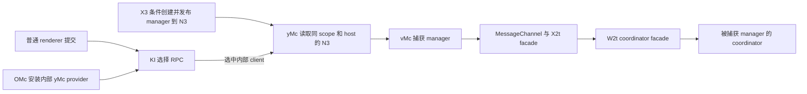

# 提交 provider、manager 与协调器的条件连接

固定基线 `codex-26.1007.30912-c5b273322a83`。本批把普通提交所选的 KI 与 provider 安装、域 manager、RPC facade 接到明确源码范围；保存 30 条契约、19 个完整单位和 10 条导入／导出关系。作者的有限校验、独立审查与冻结后核对分别为 6,165／881／722 项，当前错误均为 0。这些检查支持所述静态范围，不证明实际界面已经经过这些实例。

OMc 的 layout effect 通过 Bfn 选择 provider，再安装到 Yh／shared qI；清理时清空并 dispose。Bfn 根据 `appServerManagers` 是否存在选择内部 yMc 或 host 提供的 SMc，不能据此决定 Codex／ChatGPT 模式。X3 是另一个域 manager 注册器，没有 `forHost` 成员；不能与 qI provider 合并为同一对象。

内部分支可形成以下附带条件的源码连接：

X3.registerHost→loi→Sii 的所选条件路径直接创建 Dfn，再通过 addManager 写入 N3。X3 同时接受其他传入 manager；只有同 scope／host 的 N3 值确为该 Dfn 且 KI 选中相应 client 时，上述连接才组合到 Dfn 的既有队列／start／steer 契约。MessageChannel 的实际送达、初始化顺序和真实 UI 接收实例仍未观察。host 提供 registry 时，SMc 复制 ready entry.manager RPC 并发布连接状态，该 endpoint 没有新的 Dfn 身份证明。

KI 的 primary 条件已经更正为：provider 存在、status 不是 disconnected，且 `(status 不是 unavailable 或 host 未在 BI 登记)`。因此 unavailable 且未登记时仍允许尝试 primary；unavailable 且已登记时跳过 primary。primary 抛错后会尝试 client.rpc、缓存或延迟 RPC。源码条件与异常路径必须保留，不能统一假定提交都走 primary。

实际 UI→Dfn 和 host registry→Dfn 身份确认数仍为 0。旧 39 项 composer facets、7 个操作目录、36 个候选功能组及全局 journal 均未改写。契约与原坐标见[目录](submission-host-instance.json)，审查范围见[独立报告](submission-host-instance-peer-review.json)，原 journal 和精确复制来源见[交付记录](submission-host-instance-provenance.json)。完整单位、解析结果、输入快照与尝试历史留在本地，不进入恢复源码。

据此形成的[恢复职责与行为场景](submission-recovery-guidance.md)仍属提案，下一步需补 RPC 依赖来源、ordinary host 创建／替换，以及经授权的实际取消和执行中断恢复。
